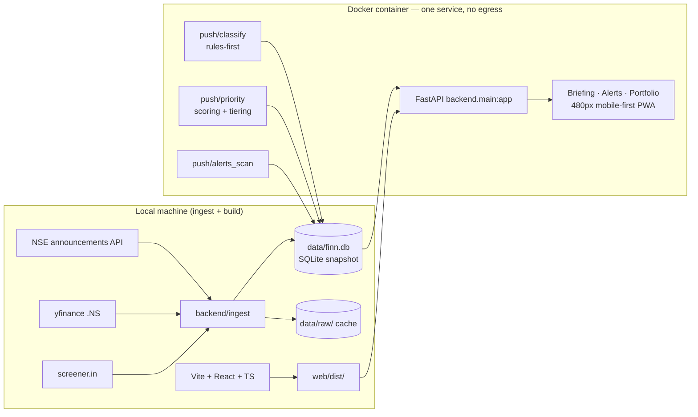

# FINN — a financial investment agent that triages, then lets you interrogate

FINN is a mobile-first briefing app for an Indian-equity investor: every refresh
it ingests exchange filings (NSE corporate announcements), prices and
fundamentals for an 18-stock portfolio, then ranks what actually matters. The
home screen is a **Briefing Stream**, not a dashboard — "34 filings overnight →
4 matter" — with three lanes (**Must-see / Worth a look / Routine**), and every
card is tappable into an enriched detail sheet.

## The interaction POV: triage, then interrogate

- **Push:** the Briefing digest (window chips 24h/3d/7d/30d, auto-widened when
  empty with a visible note) plus threshold alert rules (volume spikes, price
  moves, filing categories) with a dry-run preview.
- **Pull:** every card opens a bottom sheet with the filing, why it ranked
  ("score breakdown": category base, keyword hits, anomaly "volume 3.3x on
  filing day"), a link to the source PDF, and suggested follow-up questions.
- Priority is explainable and deterministic: `category_base × portfolio_weight
  + keyword + anomaly` where the anomaly fuses the filing with the price/volume
  move **on the filing's date** (next trading day if filed after close).
- Filings of the same company + category within 24h cluster into one digest
  item ("x5 filings"), led by the highest-scored child.

## Architecture



One FastAPI service serves both the API (`/api/*`) and the built React app at
`/`. The SQLite DB is a committed snapshot, so the deployed container works
with **no external network and no API keys** (`FINN_MODE=snapshot`).

## What is built

- **Briefing** (tiered, clustered, windowed digest with score breakdowns)
- **Alerts** (rules editor, inbox grouped per company/day, 7-day unread badge,
  30-day dry run) — rules run on every refresh
- **Portfolio** (per-stock close, day %, volume ratio, sparkline, unseen count)
- **Classifier**: subject-line rules first (NSE's `desc` IS the subject);
  filing body and voice summary only as last resort. 17 categories.
- **Per-filing price context**: day % and 20-session volume ratio at the
  filing's date, used in the UI chips and the anomaly boost.
- **Cost ledger + `/api/costs`** (zero tokens in the hosted demo).
- **Snapshot-first deploy**: `Dockerfile`, `.dockerignore`, `DEPLOY.md`.

## What is deliberately not built (yet)

- **Pull side** (company dossier, Promised-vs-Delivered timeline, cited Q&A,
  SSE streaming) — not started; the push side was prioritised end-to-end.
- **LLM calls are disabled** (`LLM_ENABLED=0`): the LLM gateway endpoint
  (Gemini) was unreachable/flaky from this network during the build, so all
  classification and summarisation runs on deterministic rules + NSE's own
  `voiceSummary` field. The gateway (`backend/llm/gateway.py`) is wired for
  cheap/strong tiers with caching, retries and a cost ledger — flipping the
  flag re-enables it without code changes. Zero LLM tokens in the hosted demo.
- Web-push/Telegram delivery, natural-language alert creation, voice input.

## Run locally

```bash
python3 -m venv .venv && source .venv/bin/activate
pip install -r requirements.txt          # runtime; add yfinance/bs4/pymupdf to refresh data
uvicorn backend.main:app --reload        # http://localhost:8000
```

To rebuild the data snapshot (local machine only, needs `yfinance`,
`beautifulsoup4` and network access):

```bash
pip install yfinance beautifulsoup4
python scripts/refresh.py                # prices + NSE 30d + screener + classify + score + alerts
```

## Data refresh model

`scripts/refresh.py` is idempotent: raw responses cached under `data/raw/`
(NSE cache keys include the date range), upserts into SQLite, then
classify → score → alert-scan. `POST /api/refresh` runs the same pipeline in
live mode; in snapshot mode it replies
`"live refresh disabled in hosted demo, data as of <date>"`.

## Model / cost notes

- Hosted demo cost: **0 LLM tokens** — classification is rule-based; routine
  summaries come from NSE's `voiceSummary`; numbers are computed from prices
  and filings, never model-generated.
- The ledger (`llm_ledger` table, `/api/costs`) records tokens/est. cost per
  step whenever `LLM_ENABLED=1`, so the "cost to build this view" is measurable.

## Honest limitations

- NSE endpoints are **unofficial** and behind bot protection; they work from
  residential IPs but datacenter IPs (Render/Fly) are commonly blocked — hence
  the snapshot-first design. BSE's API was blocked and is not used.
- Data is **as of the snapshot date** (shown in the header as "data as of
  <date>"); prices are EOD, never live.
- Screener.in fundamentals (used for company names/fundamentals) are a derived
  source, not primary filings.
- Portfolio quantities/weights are mock (`synthetic` in the data and UI).

See `DEPLOY.md` for Render / Hugging Face Spaces deployment, `DECISIONS.md`
for the decision log.
